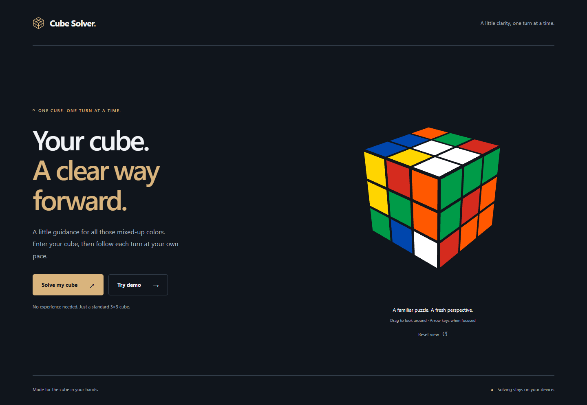
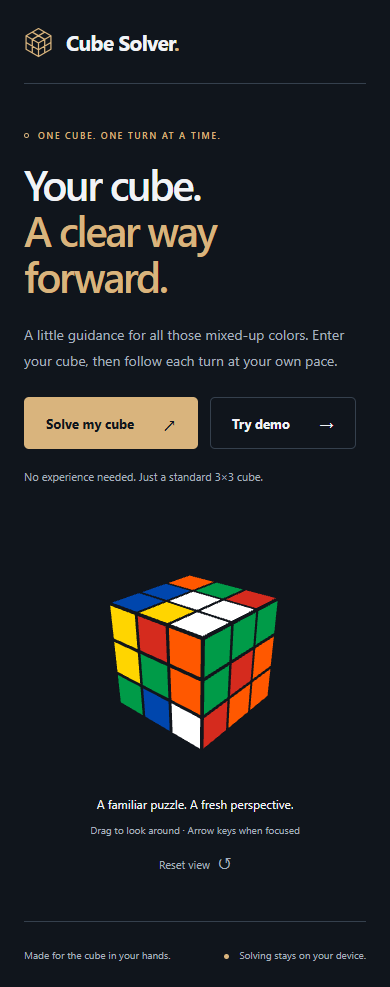

# Cube Solver

A browser-based guide for a standard 3×3 cube. **M1 — Minimal Design Foundation is complete.** M0 proved the mathematical integration; M1 adds the responsive graphite welcome, preparation screen and working demo. Color entry is the next milestone and is not available yet.

## Run

Use Node 22.14 or a compatible version satisfying Vite's engine range (20.19+ or 22.12+).

```sh
npm ci
npm run dev
npm test
npm run build
npm run test:browser
npm run preview
```

The browser suite uses locally installed Chrome and Edge. `npm run build` checks TypeScript and builds with `/Face54/` as a deliberately non-root test path. Production preview: http://localhost:4173/Face54/. This is a local address, not a deployed site. The actual repository/Pages path must be established in M6.

## Try it

- **Solve my cube** opens preparation guidance: fixed centers, white on top, green in front, and whole-cube inspection. Color entry is explicitly marked as pending M2.
- **Try demo** solves the legal M0 fixture in a browser worker. Explore individual solution boundaries with the labeled slider, inspect the solved cube, or reset the demo. This is example exploration, not the future physical-cube playback flow.
- Drag the 3D cube with a pointer or touch. Focus it and use arrow keys to rotate the camera. **Reset view** restores the home camera without changing stickers or solution progress.
- Browser Back, the wordmark, and Back to welcome navigate between screens. There are no server-side routing requirements.
- The retained M0 diagnostic harness is available at `?proof=1`, including raw facelets, timings and exact solver/mesh comparisons.

## Architecture and limits

`src/cube.ts` defines URFDLB row-major facelets and independent integer sticker geometry. `src/solver.ts` adapts cubejs and independently verifies its answer; `src/solver.worker.ts` keeps initialization off the UI thread. `src/viewer.ts` owns the Three.js scene, camera controls and renderer lifecycle. `src/CubeView.tsx` connects it to React; `src/main.tsx` owns the small hash-based welcome/prepare/demo navigation. `src/Proof.tsx` preserves the M0 harness. `src/styles.css` provides design tokens, responsive layout and focus/reduced-motion styles.

Vitest cross-checks cubejs, independent geometry, and actual meshes on 103 legal cube states. Playwright exercises production workers/WebGL under a subpath plus desktop/mobile layouts, keyboard and emulated touch interaction, navigation and failure guidance.

No arbitrary user input is accepted. Physical-state validation belongs to M3; parsing with cubejs is not proof of physical validity. Full typed worker request IDs, cancellation/retry and stale-response orchestration belong to M4; M1 only disposes its one-request demo worker when leaving the demo. Guided physical move confirmation belongs to M5. Real-cube trials and Firefox/Safari/real mobile hardware checks remain pending.

WebGL2 is required. The legacy cubejs dependency tree has 42 audit findings in the M0 snapshot, including 3 critical; these remain a release risk. The main bundle still triggers Vite's size warning. No backend, tracking, remote fonts, accounts or public deployment have been introduced.

## Screenshots





See docs/DECISIONS.md, docs/M0_REPORT.md, docs/M1_REPORT.md and context.md for engineering evidence, risks, and next action.
