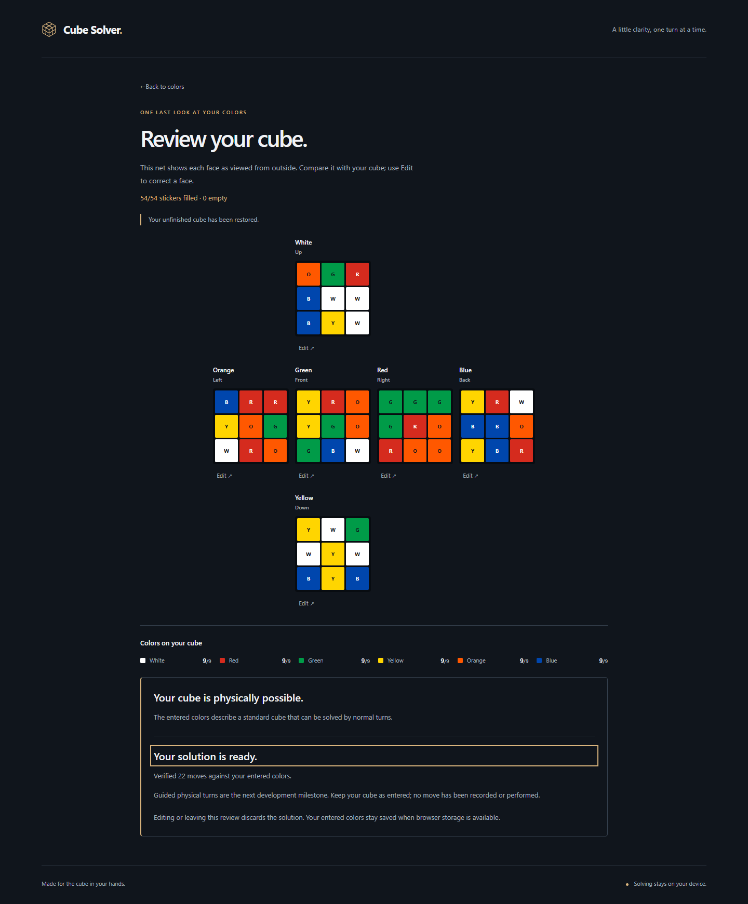
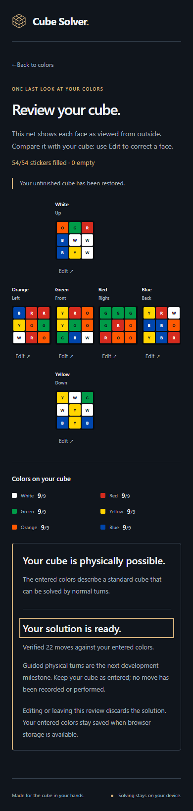

# Cube Solver

A browser-based guide for a standard 3×3 cube. M0–M3 established the verified model, graphite interface, guided input and physical validation. **M4 computes and verifies solutions to entered colors locally in a Web Worker.** Guided physical turns are pending M5.

## Run

Use Node 22.14 or a compatible version satisfying Vite's engine range (20.19+ or 22.12+).

```sh
npm ci
npm run dev
npm test
npm run build
npm run test:browser
npm run preview
```

The browser suite uses locally installed Chrome and Edge. `npm run build` checks TypeScript and builds with `/Face54/` as a deliberately non-root test path. Production preview: http://localhost:4173/Face54/. This is a local address, not a deployed site. The actual repository/Pages path must be established in M6.

## Try it

- **Solve my cube** opens preparation guidance, then **Enter cube colors** opens the six-face editor. First-time faces show an animated whole-cube reference with named above/right landmarks. It shrinks after orienting and can be hidden or reopened. Reduced motion skips the animation.
- Select a labeled palette color, then paint a sticker. The next empty spot on that face is selected without painting it or changing faces. Centers stay fixed. Paint a previous sticker again to correct it. Arrow keys move through editable spots, Enter/Space paints, and Tab reaches all controls.
- Navigate between incomplete faces with the face tabs or Previous/Next. Clear face keeps its center and all other faces. Live counts include centers and warn about more than nine of a color without rejecting partial entries.
- A versioned local draft saves entered colors and the current face, validates before restoring, and survives navigation/refresh. Blocked storage shows guidance while edits stay in memory. Start new cube asks before discarding existing work.
- **Review cube** shows an outside-view net, completion and color counts. **Check cube** checks completeness, counts, centers, edge/corner identities, uniqueness, orientation sums and permutation parity without changing entries. **Edit** returns to a face and marks missing entries or groups worth rechecking when the evidence supports it. Global parity errors cannot identify an individual sticker, so those do not highlight any. Editing clears old validation results; check again after corrections.
- Valid colors continue to local solving. **Cancel solving** stops work without changing colors; **Try again** starts a fresh worker after cancellation or failure. Verified results show a move count; already-solved input needs no search tables or moves. Leaving review or editing discards the solution, and refresh restores only input. Physical move guidance is not implemented yet; no physical turn is recorded.
- **Try demo** solves the legal M0 fixture in a browser worker. Explore individual solution boundaries with the labeled slider, inspect the solved cube, or reset the demo. This is example exploration, not the future physical-cube playback flow.
- Drag the 3D cube with a pointer or touch. Focus it and use arrow keys to rotate the camera. **Reset view** restores the home camera without changing stickers or solution progress.
- Browser Back, the wordmark, and Back to welcome navigate between screens. There are no server-side routing requirements.
- The retained M0 diagnostic harness is available at `?proof=1`, including raw facelets, timings and exact solver/mesh comparisons.

## Architecture and limits

`src/cube.ts` defines URFDLB row-major facelets and independent sticker geometry. `src/orientation.ts` defines grid indices, landmarks and camera poses. `src/input.ts` represents partial input as canonical `Face | null` slots and provides immutable editing/count operations. `src/persistence.ts` validates and saves the minimal draft; `src/useDraft.ts` keeps it at app scope across navigation. `src/InputEditor.tsx` and `src/OrientationGuide.tsx` own entry and the reference lifecycle.

`src/validation.ts` independently decodes standard cubies and validates physical solvability; it imports neither renderer nor solver. `src/Review.tsx` provides the net, checks and corrections, then mounts `src/SolvePanel.tsx` for the exact validated snapshot. Validation results/highlights and solutions are transient; they are never saved as cube input. cubejs parsing and even a facelet round-trip accept impossible states, so neither is used as a physical-validity check.

`src/solver.ts` wraps the existing cubejs solver. `src/solverProtocol.ts` defines typed requests/progress/results/errors, runtime checks and independent move verification. `src/solver.worker.ts` validates again and performs preparation/search off the main thread. `src/solverClient.ts` binds unique request IDs to exact input snapshots, verifies returned moves again, handles crashes/message failures and stops work on cancellation, disposal or a 60-second timeout. Completed/failed workers are released; retries rebuild tables. The demo and M0 proof use this same client. `src/viewer.ts` owns Three.js and exact mesh readback; rendering and canonical mathematics remain separate.

Vitest cross-checks 103 solver/renderer states plus 103 typed pipeline requests, input/orientation/persistence invariants, 1,000 legal validation states and impossible fixtures. Worker tests cover initialization/search/verification failures, stale IDs/late callbacks, cancellation, timeout and recovery. Playwright covers production workers/WebGL, all 48 editable slots through verified solving, input restoration/correction, invalid states, real worker cancellation/retry, load failure recovery, wrong-output rejection, stale-solution removal, desktop/mobile, keyboard and emulated touch.

Entered colors remain unchecked until Check cube succeeds. Counts alone or library parsing are not proof of physical validity. A verified solution is mathematical evidence for those colors, not proof that input matches the physical cube or that a physical turn occurred. Guided physical confirmation belongs to M5. Real-cube trials, Firefox/Safari, real mobile hardware and full assistive-technology checks remain pending.

WebGL2 is required for 3D. Text orientation instructions and editing remain available if the reference cannot initialize. The legacy cubejs dependency tree has 42 audit findings in the M0 snapshot, including 3 critical; these remain a release risk. The main bundle still triggers Vite's size warning. No backend, tracking, remote fonts, accounts or public deployment have been introduced.

## Screenshots





See docs/DECISIONS.md, docs/M0_REPORT.md through docs/M4_REPORT.md and context.md for engineering evidence, risks, and next action.
