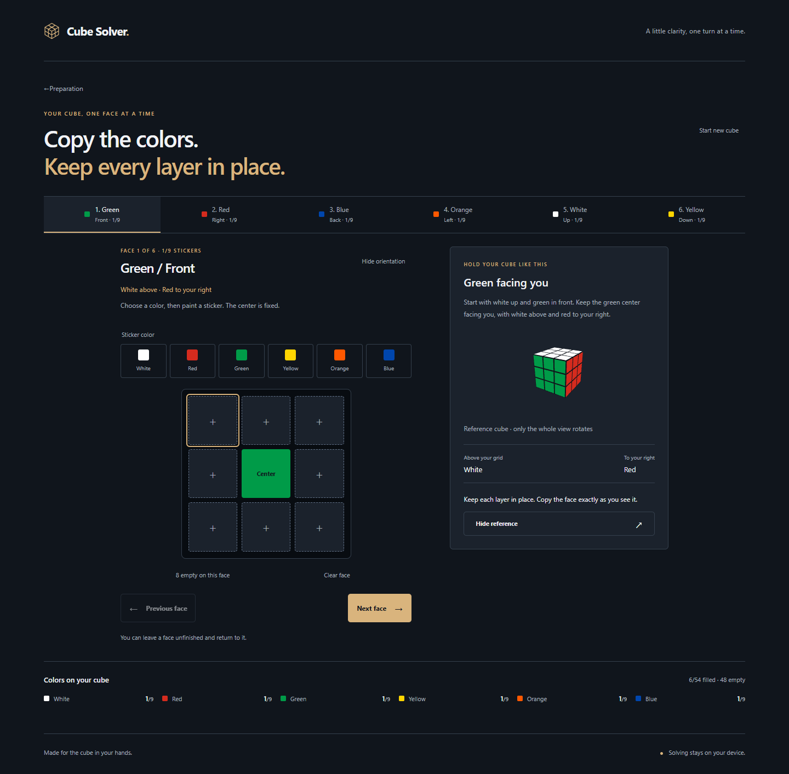
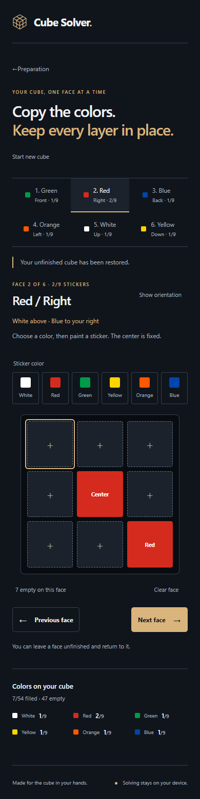

# Cube Solver

A browser-based guide for a standard 3×3 cube. M0 proved the mathematical integration; M1 established the graphite foundation; **M2 adds guided six-face color entry and local draft persistence**. Physical-state checking is the next milestone and is not available yet.

## Run

Use Node 22.14 or a compatible version satisfying Vite's engine range (20.19+ or 22.12+).

```sh
npm ci
npm run dev
npm test
npm run build
npm run test:browser
npm run preview
```

The browser suite uses locally installed Chrome and Edge. `npm run build` checks TypeScript and builds with `/Face54/` as a deliberately non-root test path. Production preview: http://localhost:4173/Face54/. This is a local address, not a deployed site. The actual repository/Pages path must be established in M6.

## Try it

- **Solve my cube** opens preparation guidance, then **Enter cube colors** opens the six-face editor. First-time faces show an animated whole-cube reference with named above/right landmarks. It shrinks after orienting and can be hidden or reopened. Reduced motion skips the animation.
- Select a labeled palette color, then paint a sticker. The next empty spot on that face is selected without painting it or changing faces. Centers stay fixed. Paint a previous sticker again to correct it. Arrow keys move through editable spots, Enter/Space paints, and Tab reaches all controls.
- Navigate between incomplete faces with the face tabs or Previous/Next. Clear face keeps its center and all other faces. Live counts include centers and warn about more than nine of a color without rejecting partial entries.
- A versioned local draft saves entered colors and the current face, validates before restoring, and survives navigation/refresh. Blocked storage shows guidance while edits stay in memory. Start new cube asks before discarding existing work.
- **Try demo** solves the legal M0 fixture in a browser worker. Explore individual solution boundaries with the labeled slider, inspect the solved cube, or reset the demo. This is example exploration, not the future physical-cube playback flow.
- Drag the 3D cube with a pointer or touch. Focus it and use arrow keys to rotate the camera. **Reset view** restores the home camera without changing stickers or solution progress.
- Browser Back, the wordmark, and Back to welcome navigate between screens. There are no server-side routing requirements.
- The retained M0 diagnostic harness is available at `?proof=1`, including raw facelets, timings and exact solver/mesh comparisons.

## Architecture and limits

`src/cube.ts` defines URFDLB row-major facelets and independent sticker geometry. `src/orientation.ts` defines grid indices, landmarks and camera poses. `src/input.ts` represents partial input as canonical `Face | null` slots and provides immutable editing/count operations. `src/persistence.ts` validates and saves the minimal draft; `src/useDraft.ts` keeps it at app scope across navigation. `src/InputEditor.tsx` and `src/OrientationGuide.tsx` own entry and the reference lifecycle.

`src/solver.ts` and `src/solver.worker.ts` remain the verified M0 pipeline. `src/viewer.ts` owns the Three.js scene, camera controls, short orientation transition and exact mesh readback. `src/CubeView.tsx` supports the existing welcome/demo views. `src/main.tsx` owns hash-based welcome/prepare/input/demo navigation; `src/Proof.tsx` preserves the M0 harness; `src/styles.css` supplies shared styles.

Vitest cross-checks 103 legal cube states and input/orientation/persistence invariants. Playwright covers production workers/WebGL, all 48 editable slots reproducing the exact M0 fixture, six orientation references, refresh, corrections, incomplete faces, count warnings, confirmation, storage failures, desktop/mobile layouts, keyboard and emulated touch.

Entered colors remain explicitly unchecked and are never sent to the solver in M2. Physical-state validation belongs to M3; counts or parsing are not proof of physical validity. Entered-state solving, typed worker requests, cancellation/retry and stale-response orchestration belong to M4. Guided physical confirmation belongs to M5. Real-cube orientation/solving trials, Firefox/Safari, real mobile hardware and full assistive-technology checks remain pending.

WebGL2 is required for 3D. Text orientation instructions and editing remain available if the reference cannot initialize. The legacy cubejs dependency tree has 42 audit findings in the M0 snapshot, including 3 critical; these remain a release risk. The main bundle still triggers Vite's size warning. No backend, tracking, remote fonts, accounts or public deployment have been introduced.

## Screenshots





See docs/DECISIONS.md, docs/M0_REPORT.md, docs/M1_REPORT.md, docs/M2_REPORT.md and context.md for engineering evidence, risks, and next action.
