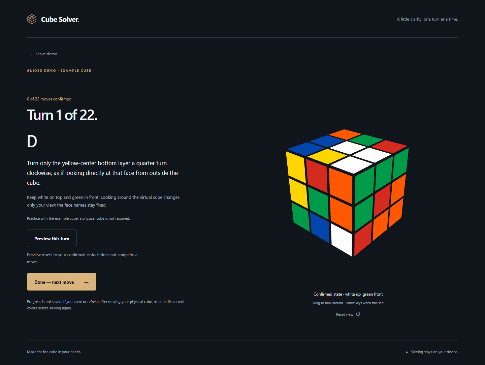
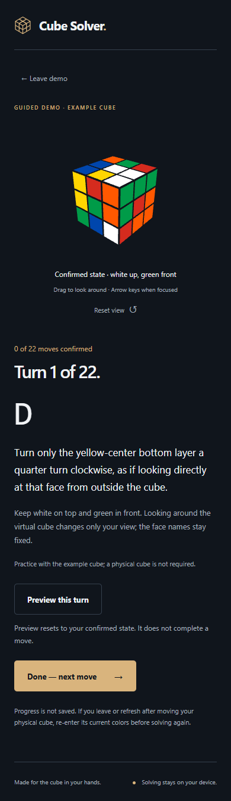

# Cube Solver

A browser-based guide for a standard 3×3 cube: guided entry, physical validation, verified local worker solving and manual turn-by-turn guidance. **M6 release preparation is implemented locally; final acceptance is incomplete.** Physical cube trials and public deployment verification remain pending.

## Run

Use Node 22.12+ (verified with 22.14.0). The accessibility tooling requires this minimum.

```sh
npm ci
npm run dev
npm run lint
npm run typecheck
npm test
npm audit --audit-level=low
npm run build
npm run test:browser
npm run preview
```

The browser suite uses locally installed Chrome and Edge. `npm run build` checks vendored source integrity, generates runtime license notices, checks TypeScript and builds with `/Face54/`. The configured repository is `abbasikhadija/Face54`; the project now has its own Git root. Dev/production preview use the same base. Production preview: http://localhost:4173/Face54/.

The intended public URL is https://abbasikhadija.github.io/Face54/ — it returned **404 on 2026-10-23**. This repository does not claim a live deployment.

## Try it

- **Solve my cube** opens preparation guidance, then **Enter cube colors** opens the six-face editor. First-time faces show an animated whole-cube reference with named above/right landmarks. It shrinks after orienting and can be hidden or reopened. Reduced motion skips the animation.
- Select a labeled palette color, then paint a sticker. The next empty spot on that face is selected without painting it or changing faces. Centers stay fixed. Paint a previous sticker again to correct it. Arrow keys move through editable spots, Enter/Space paints, and Tab reaches all controls.
- Navigate between incomplete faces with the face tabs or Previous/Next. Clear face keeps its center and all other faces. Live counts include centers and warn about more than nine of a color without rejecting partial entries.
- A versioned local draft saves entered colors and the current face, validates before restoring, and survives navigation/refresh. Blocked storage shows guidance while edits stay in memory. Start new cube asks before discarding existing work.
- **Review cube** shows an outside-view net, completion and color counts. **Check cube** checks completeness, counts, centers, edge/corner identities, uniqueness, orientation sums and permutation parity without changing entries. **Edit** returns to a face and marks missing entries or groups worth rechecking when the evidence supports it. Global parity errors cannot identify an individual sticker, so those do not highlight any. Editing clears old validation results; check again after corrections.
- Valid colors continue to local solving. **Cancel solving** stops work without changing colors; **Try again** starts a fresh worker after cancellation or failure. **Start guided solving** opens the exact entered 3D state. Hold white up/green front, compare all faces, then follow one turn at a time. Already-solved input needs no search tables or moves.
- **Preview this turn** demonstrates only the current layer, then restores your confirmed state. Reduced motion shows a static endpoint. Make the physical turn, then press **Done — next move**. **Previous — undo a turn** explains the reverse turn; only **I undid this turn** moves progress backward. Camera inspection and Reset view never redefine face names or confirm turns. Confirmation is disabled if the renderer cannot verify its state.
- **Try demo** uses the same real worker and guided journey with the one legal M0 fixture. It advances only on confirmation; there is no automatic full-solution playback or product seek slider. Completion shows the solved cube, move count and **Solve another cube**. Finishing a real cube clears its draft when starting another; the demo preserves unrelated entered colors.
- Progress/solutions are not saved. Leaving playback asks for confirmation; refreshing/directly opening `#play` explains that current physical colors must be re-entered. Browser Back and the wordmark also discard progress. If you have moved your physical cube, re-enter its current colors before solving again. Saved input remains the original entered snapshot until you change it.
- Drag the 3D cube with a pointer or touch. Focus it and use arrow keys to rotate the camera. **Reset view** restores the home camera without changing stickers or solution progress.
- Browser Back, the wordmark, and Back to welcome navigate between screens. There are no server-side routing requirements.
- The retained M0 diagnostic harness is available at `?proof=1`, including raw facelets, timings and exact solver/mesh comparisons.

## Architecture and limits

`src/cube.ts` defines URFDLB row-major facelets and independent sticker geometry. `src/orientation.ts` defines grid indices, landmarks and camera poses. `src/input.ts` represents partial input as canonical `Face | null` slots and provides immutable editing/count operations. `src/persistence.ts` validates and saves the minimal draft; `src/useDraft.ts` keeps it at app scope across navigation. `src/InputEditor.tsx` and `src/OrientationGuide.tsx` own entry and the reference lifecycle.

`src/validation.ts` independently decodes standard cubies and validates physical solvability; it imports neither renderer nor solver. `src/Review.tsx` provides the net, checks and corrections, then mounts `src/SolvePanel.tsx` for the exact validated snapshot. Validation results/highlights and solutions are transient; they are never saved as cube input. cubejs parsing and even a facelet round-trip accept impossible states, so neither is used as a physical-validity check.

`src/solver.ts` wraps the existing cubejs solver. `src/solverProtocol.ts` defines typed requests/progress/results/errors, runtime checks and independent move verification. `src/solver.worker.ts` validates again and performs preparation/search off the main thread. `src/solverClient.ts` binds unique request IDs to exact input snapshots, verifies returned moves again, handles crashes/message failures and stops work on cancellation, disposal or a 60-second timeout. Completed/failed workers are released; retries rebuild tables. The demo and M0 proof use this same client. `src/viewer.ts` owns Three.js and exact mesh readback; rendering and canonical mathematics remain separate.

Domain colors live in `src/colors.ts`. The WebGL renderer and technical proof load on demand; opening review/input without a 3D reference does not eagerly fetch the renderer. Graphics loss stops previews and blocks physical confirmation; a renderer-download failure gives recovery guidance while color entry stays usable.

`src/playback.ts` verifies a plan, derives canonical boundaries, maps all 18 turns to plain-English outside-face directions and implements explicit forward/undo transitions without renderer dependencies. `src/GuidedPlayback.tsx` owns transient confirmed progress and the separate preview lifecycle. Actual sticker meshes and their body pieces turn in the viewer; endpoint readback must match the mathematical move, then return exactly to the confirmed state. Work runs only during requested previews or camera interaction.

Vitest cross-checks solver/renderer and typed pipeline cases, input/orientation/persistence, physical validation, 100 deterministic playback plans, every turn's actual mesh endpoint/restoration and body transforms. Playwright covers production workers/WebGL, all 48 editable slots through confirmed completion, complete guided demo, all 18 animated previews, explicit undo, camera/notation independence, reduced motion, keyboard/native emulated touch, navigation/refresh, worker recovery, desktop/mobile and existing input/validation regressions. M6 adds automated WCAG A/AA axe checks across task states/dialogs, 320 px reflow, simulated 200% CSS zoom, renderer chunk failure, graphics-context loss, base-path/notices loading and absence of external service requests. These checks do not constitute a full screen-reader audit.

Entered colors remain unchecked until Check cube succeeds. Counts alone or library parsing are not proof of physical validity. A verified solution and user confirmation cannot prove that input matches the physical cube or that a physical turn occurred. Real-cube trials, Firefox/Safari, real mobile hardware and full assistive-technology checks remain pending.

WebGL2 is required for 3D. Text orientation instructions and editing remain available if the reference cannot initialize. No backend, tracking, remote fonts or accounts are used.

## Dependencies and release

The old cubejs package installed an unused npm 6 CLI tree with 42 findings (3 critical). `vendor/cubejs` now packages only the unchanged cubejs 1.3.2 runtime and MIT license. All four files were compared with a freshly downloaded official registry tarball; recorded SHA-256 checks run on every build. The existing guarded module-worker compatibility transform remains. This preserves the solver algorithm/API while removing the vulnerable CLI tree. Future upstream security/source/license review is still required; local vendored packages are not automatically upgraded by npm audit.

Fresh M6 npm audit reports zero known vulnerabilities in the resolved dependency tree; before/after snapshots are in docs/npm-audit-m6-before.json and docs/npm-audit-m6-after.json. Direct versions and the lockfile are pinned. Build-generated [third-party runtime notices](public/THIRD_PARTY_NOTICES.txt) ship with the site and preserve all five MIT runtime package notices. No application-wide license was chosen automatically.

Initial JavaScript decreased from 812.39 kB / 218.55 kB gzip to about 263.56 kB / 82.13 kB gzip; the on-demand renderer is 549.61 kB / 136.83 kB gzip and retains Vite's >500 kB warning. Total renderer cost still exists when 3D is requested. Cold solver initialization still takes seconds. These are local observations, not hardware-independent promises.

`.github/workflows/quality.yml` runs lint/type/unit/audit/build and Chrome/Edge production tests for PRs and main pushes. `.github/workflows/pages.yml` publishes only through an explicitly approved manual dispatch from main, after repeating those checks. To publish a preview: select **Settings → Pages → Build and deployment → Source: GitHub Actions**, then **Actions → Publish approved build to Pages → Run workflow**, choose main and approve publication. This publishes compiled `dist/`; **Deploy from a branch** instead serves the raw source through Jekyll and cannot run this Vite app. Publication approval does not claim physical trials passed. Record both trials in [PHYSICAL_ACCEPTANCE.md](docs/PHYSICAL_ACCEPTANCE.md) and verify workers, renderer, demo and manual-input journey on the actual public URL before M6 final acceptance. Nothing was committed, pushed, dispatched or deployed by the agent.

## Screenshots





See docs/DECISIONS.md, docs/M0_REPORT.md through docs/M6_REPORT.md and context.md for engineering evidence, risks, and next action.
